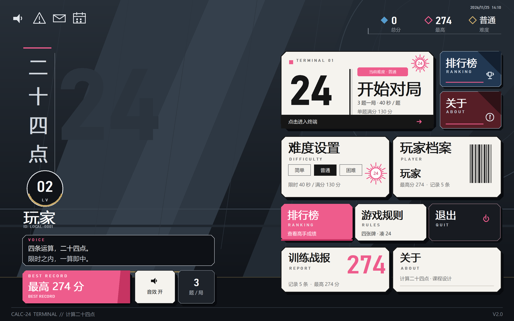
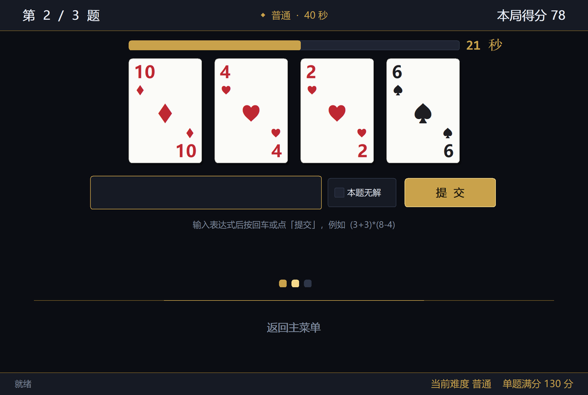
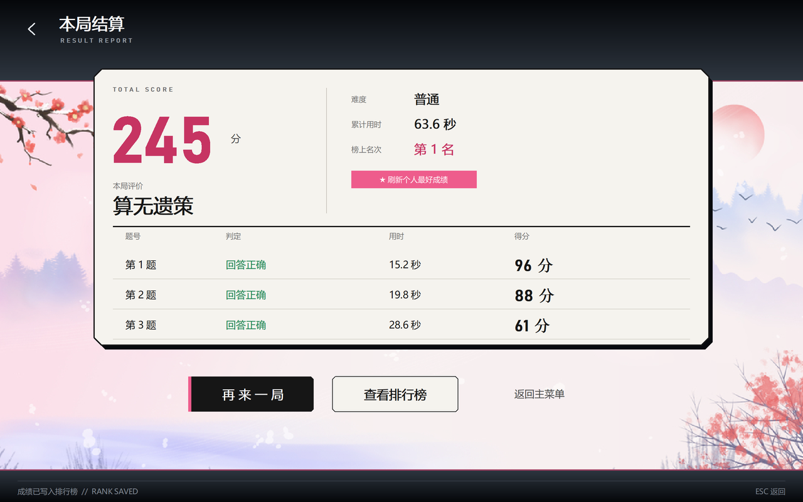
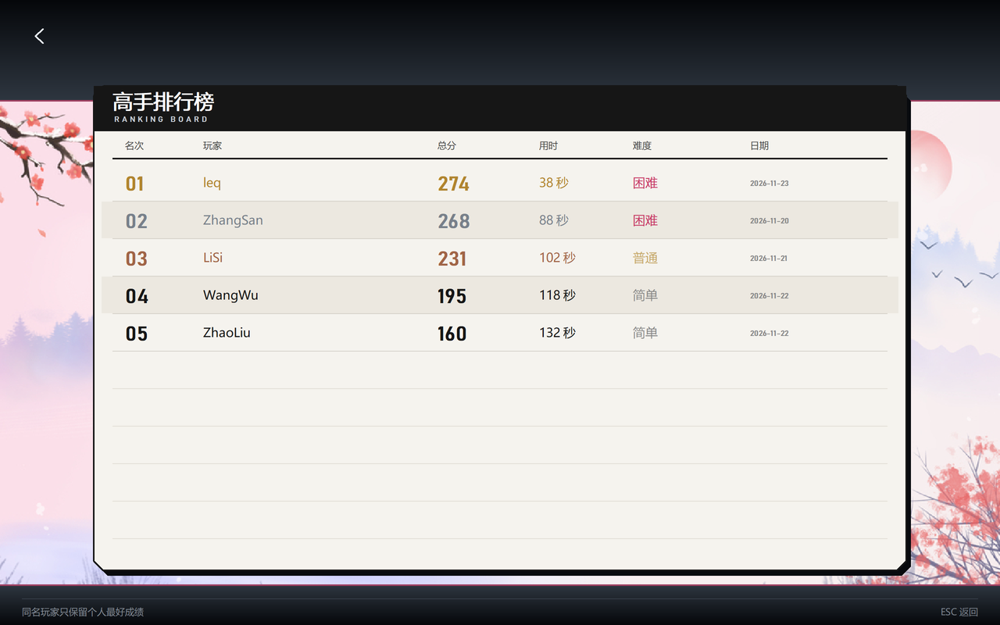
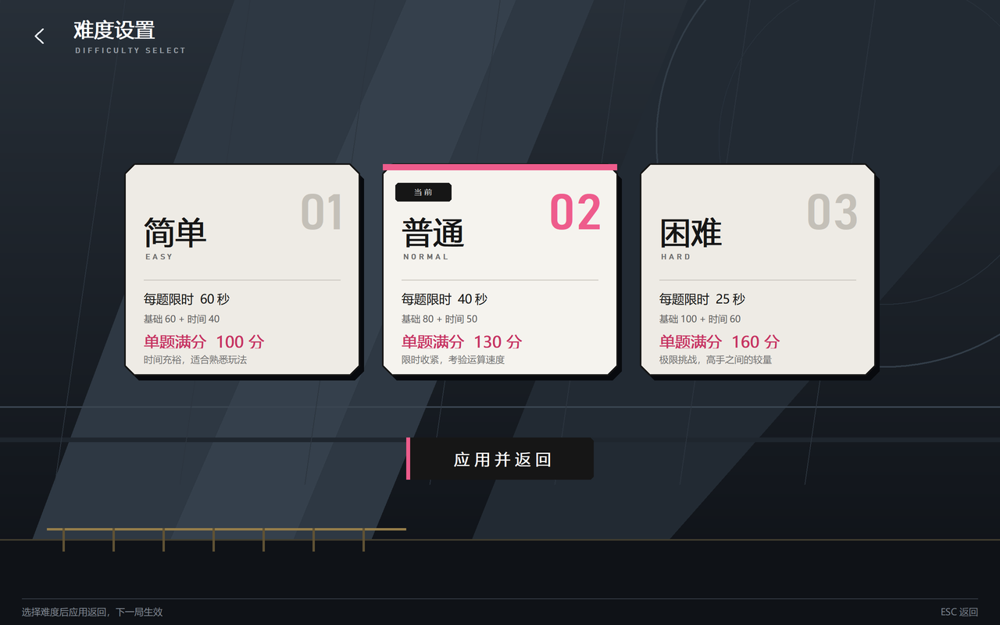
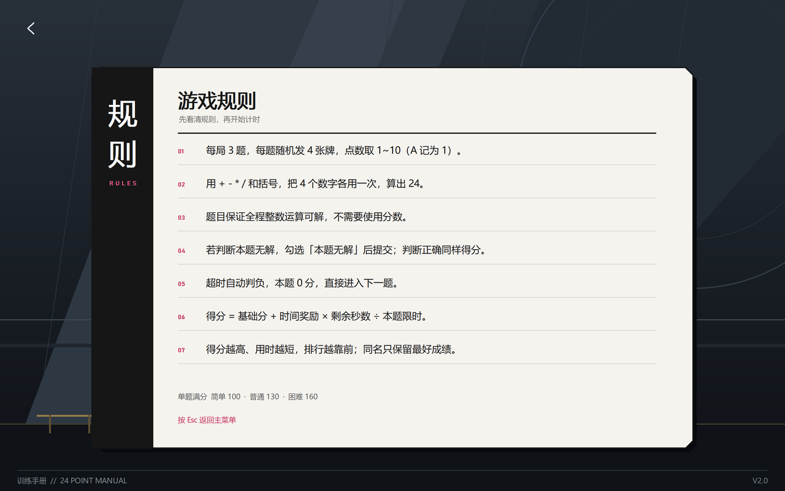

# 24 Point Game

[简体中文](README.md) | **English**

Course project for *Programming (Lab)* at Nanjing University of Posts and Telecommunications.

A small Windows desktop game written in plain Win32 API + GDI: four playing cards
(values 1–10) are dealt at random, and the player must type an arithmetic expression
that evaluates to 24 before the timer runs out.

The UI theme is "Jièyuán Terminal" (CALC-24 TERMINAL V2.0): a pink gradient backdrop
with a semi-transparent ink-wash landscape image, off-white cut-corner cards and magenta
accents. Every card, playing card, progress bar, button and barcode is hand-drawn with GDI.



## Features

- **Native window** — standard title bar (minimize / maximize / close), menu bar, freely resizable; when maximized the layout scales proportionally to fill the screen
- **Puzzle generation** — four cards with values 1–10 drawn at random; every deal is guaranteed to be solvable with integer arithmetic only (no fractions needed), and each round always contains exactly one unsolvable hand
- **Three difficulty levels** — Easy 60 s / Normal 40 s / Hard 25 s; a harder level means a higher base score and time bonus (max 100 / 130 / 160 per question)
- **Exact evaluation** — all arithmetic uses rational numbers (numerator/denominator pairs of `long long`), never floating point, so edge cases such as `8/(3-8/3)` are judged exactly
- **Leaderboard** — sorted by total score descending, then time ascending; only a player's personal best is kept, and each entry records its difficulty
- **Voice feedback** — a chime when a game starts, a reminder at half time, right/wrong feedback per question and a verdict at the summary; background music loops and automatically steps aside while a sound effect plays
- **Built-in self-test** — 25 checks covering the solver, the parser and the audio/bitmap assets, plus a 20,000-hand randomized consistency run

| | |
|---|---|
|  |  |
|  |  |
|  |  |

## Building

### Option 1: one-command build (recommended)

Requires `g++` and `windres` from MinGW-w64 / TDM-GCC — either on `PATH` or in one of the
common install directories, which the script probes automatically.

```powershell
.\build.ps1
```

Or press `Ctrl+Shift+B` in VS Code (runs the 「构建」 task in `.vscode/tasks.json`).

The script first packs `音频\*.mp3` and `图片\背景.bmp` into a resource object with `windres`,
then statically links a single-file exe that does not depend on `libstdc++-6.dll`.

### Debug build

```powershell
.\build.ps1 -Debug
```

Produces `calc24-debug.exe` (`-g -O0`, symbols kept) for gdb breakpoint debugging; without
the switch it still produces the optimized `计算24点游戏.exe`.
In VS Code, pick the 「C++ 调试 · 计算24点游戏 (MinGW gdb)」 configuration — it runs the
「构建(调试)」 task first and then launches gdb.

### Option 2: manual build

```bash
windres src/计算24点游戏.rc -O coff -o src/资源.o --codepage=936
g++ -std=c++11 -O2 -mwindows -static -static-libgcc -static-libstdc++ -s \
    -o 计算24点游戏.exe src/计算24点游戏.cpp src/资源.o -lgdi32 -lwinmm -lmsimg32
```

- `-mwindows` — build a GUI subsystem app without the black console window
- `-lwinmm` — MCI audio API
- `-lmsimg32` — `AlphaBlend`, used to composite the background image
- `--codepage=936` — the resource script references Chinese file names, so it must be parsed as GBK
- `-static -s` — statically link the runtime and strip symbols, so the exe runs on any machine

> ⚠️ **The source files are GBK / ANSI encoded.** When opening them in VS Code choose
> “Reopen with Encoding → GBK”. **Never save them as UTF-8** — that permanently corrupts
> the Chinese string literals in the source.

### Editor IntelliSense

VS Code uses clangd for C/C++ hints by default, but clangd ships with MSVC header search
paths, so it cannot find `windows.h` and floods the editor with bogus errors such as
`'windows.h' file not found` and `Unknown type name 'COLORREF'` — even though compiling
with g++ works fine. Two config files are included to solve this:

- `compile_flags.txt` — tells clangd to target MinGW (`--target=x86_64-w64-windows-gnu`) and where w64devkit's headers live;
- `.clangd` — suppresses two known clashes (`builtin_definition`, `redefinition_different_typedef`) that occur when clang parses mingw-w64 headers; they are not issues in this project's code.

If you use a different toolchain location or GCC version, edit the paths in
`compile_flags.txt` (run `g++ -E -v -x c++ nul` to see the actual
`#include <...> search starts here` list).
`.vscode/c_cpp_properties.json` is the equivalent configuration for the Microsoft C/C++ extension.

## Running

Just double-click `计算24点游戏.exe`. The audio is embedded in the exe, so a
**single file copied to someone else's machine still plays sound**.

If an `音频\` folder sits next to the exe, external assets take priority — handy for
swapping sound effects.

The background is drawn by `paintBackground`: a pink-to-white gradient base, a semi-transparent
ink-wash landscape (`图片\背景.bmp`, with the watermark at the bottom of the original image
cropped away) composited on top, and finally two gradient black bands pressed against the top
and bottom edges. The image is scaled with “cover” semantics and centre cropping, so it is never
stretched. The opacity of the `AlphaBlend` composite is controlled by `BG_ALPHA` — raise it for
a more vivid picture, lower it for clearer text. Everything is laid out on a 1280×800 logical
canvas; the backdrop is rendered once at the real pixel size into a cached bitmap, and every
subsequent frame just blits it. If the bitmap resource is missing (e.g. the resources were not
compiled in), the drawing silently falls back to the pure gradient and the UI stays intact.

Command-line arguments:

| Argument | Description |
|---|---|
| `--selftest` | Run the built-in self-test; exit code 0 means everything passed |
| `--selftest --log` | Same, but write the results to `selftest.log` instead of a console |
| `--shots` | Export each screen as a BMP, used for the report figures |

## Project layout

```
计算24点游戏/
├── 计算24点游戏.exe     entry point
├── rank.txt             leaderboard data (written by the game, git-ignored)
├── 音频\                7 mp3 sound assets
├── 图片\背景.bmp         background image (ink-wash landscape, embedded in the exe)
├── build.ps1            one-command build script (locates g++ / windres)
├── compile_flags.txt    clangd flags (MinGW target and include paths)
├── .clangd              clangd config (suppresses known mingw header false positives)
├── .vscode\             VS Code build / run tasks
├── src\                 source code
│   ├── 计算24点游戏.cpp  main program (GBK encoded, ~3850 lines)
│   ├── 计算24点游戏.c++  identical submission copy of the source
│   └── 计算24点游戏.rc   resource script (mp3 as RCDATA, background as BITMAP)
├── doc\
│   ├── 使用说明.txt       detailed manual and defence notes
│   └── screenshots\     UI screenshots
├── README.md            Chinese version
├── README.en.md         English version (this file)
└── .gitignore
```

> The executable, `音频\` and `rank.txt` must live in the same directory: the program uses
> `GetModuleFileName` to locate its own folder and resolves assets and data relative to it.

## Implementation notes

- **Solver** — recursively enumerate every combination of “take any two numbers and apply one
  operation”. Each level has C(n,2) pairs × 6 operand orders, and the search is exhaustive, so
  “no solution” is decided exactly. An extra `intOnly` flag requires every intermediate result to
  be an integer; puzzle generation uses it to reject hands that can only be solved with fractions.
- **Expression parser** — recursive descent (expression → term → factor) sharing the same exact
  fraction arithmetic as the solver, so the player's answer is judged by exactly the same
  standard used to generate the puzzle.
- **Rendering** — the whole client area is owner-drawn. `WM_PAINT` first renders the frame into a
  memory bitmap and then performs a single `BitBlt` (strict double buffering: only one blit is
  ever allowed onto the window DC), combined with the `MM_ANISOTROPIC` mapping mode for
  proportional scaling. The countdown repaints only its own strip, which avoids full-screen
  refreshes and the flicker they cause.
- **Background image** — `图片\背景.bmp` is compiled in as a BITMAP resource, scaled to the content
  area with “cover” semantics and centre cropping, then composited semi-transparently over the
  gradient with `AlphaBlend` (opacity: `BG_ALPHA` in the source). To change it, replace the bmp
  and rebuild.
- **Audio** — asynchronous playback through MCI's `mciSendString`. Background music and sound
  effects use two separate aliases: a sound effect first issues `pause bgm` and, once
  `MM_MCINOTIFY` reports completion, `resume bgm` restores the music.

## Credits

The UI redesign (the “Jièyuán Terminal” theme, the 1280×800 design canvas, and the cut-corner
card and icon drawing routines) was done by a teammate. The logic layer (solver, scoring,
leaderboard, audio, self-test) and the first version of the UI are the repository's existing code.
