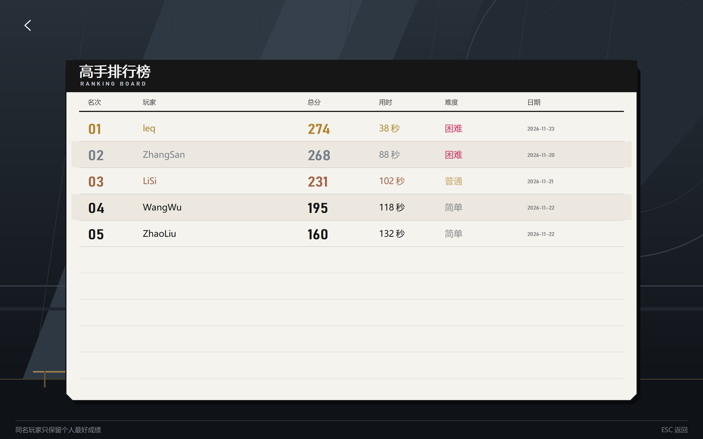

# 计算 24 点游戏 · 24 Point Game

南京邮电大学《程序设计（上机）》课程设计作品。

一个纯 Win32 API + GDI 自绘的 Windows 桌面小游戏：随机发 4 张扑克牌（点数 1~10），
玩家在限时内输入四则运算表达式，使结果等于 24。

界面主题为「界园终端」（CALC-24 TERMINAL V2.0）：深蓝灰底 + 米白切角卡片 + 品红强调，
所有卡片、扑克牌、进度条、按钮、条形码均由 GDI 手绘。


## 功能

- **原生窗口**：标准标题栏（最小化 / 最大化 / 关闭）、菜单栏、可自由缩放，最大化时界面等比铺满
- **题库**：随机出 1~10 的四张牌，保证全程用整数四则运算即可解出（不涉及小数）；每局固定含 1 道无解题
- **三档难度**：简单 60 秒 / 普通 40 秒 / 困难 25 秒，难度越高基础分与时间奖励越高（单题满分 100 / 130 / 160）
- **精确求值**：全程有理数（分数）运算，不使用浮点，避免 `8/(3-8/3)` 这类边界误判
- **排行榜**：按总分降序、用时升序排列，同名玩家只保留最好成绩，记录难度
- **语音反馈**：开场「叮叮叮」、时间过半提醒、答对/答错反馈、结算褒贬；背景音乐循环播放，音效响起时自动让位
- **内置自检**：25 项算法、解析器与素材检查 + 20000 组随机题自洽性验证

| | |
|---|---|
|  |  |
|  |  |
|  |  |

## 编译

### 方式一：一键构建（推荐）

需要 MinGW-w64 / TDM-GCC 的 `g++` 与 `windres`（在 PATH 中，或装在常见目录下即可自动找到）。

```powershell
.\build.ps1
```

或在 VS Code 中按 `Ctrl+Shift+B`（走 `.vscode/tasks.json` 里的「构建」任务）。

脚本会先 `windres` 把 `音频\*.mp3` 打进资源，再静态链接出单文件 exe（不依赖 `libstdc++-6.dll`）。

### 方式二：手动编译

```bash
windres src/计算24点游戏.rc -O coff -o src/资源.o --codepage=936
g++ -std=c++11 -O2 -mwindows -static -static-libgcc -static-libstdc++ -s \
    -o 计算24点游戏.exe src/计算24点游戏.cpp src/资源.o -lgdi32 -lwinmm
```

- `-mwindows`：生成窗口程序，不带黑色控制台
- `-lwinmm`：MCI 音频接口
- `--codepage=936`：资源脚本里是中文文件名，需要按 GBK 解析
- `-static -s`：静态链接运行库并去符号，exe 换台机器也能跑

> ⚠️ **源文件为 GBK / ANSI 编码**。用 VS Code 打开请选择「通过编码重新打开 → GBK」，
> **千万不要另存为 UTF-8**，否则源码里的中文字符串会被永久破坏。

## 运行

双击 `计算24点游戏.exe` 即可。声音已打包进 exe，**单独一个文件拷给别人也能出声**。

如果 exe 旁边存在 `音频\` 目录，会优先使用外置素材（方便替换音效）。

命令行参数：

| 参数 | 说明 |
|---|---|
| `--selftest` | 运行内置自检，返回码 0 表示全部通过 |
| `--selftest --log` | 同上，但把结果写入 `selftest.log` 而不是弹出控制台 |
| `--shots` | 导出各界面截图（BMP），用于报告插图 |

## 目录结构

```
计算24点游戏/
├── 计算24点游戏.exe     运行入口
├── rank.txt             排行榜数据（程序自动读写，已在 .gitignore 中）
├── 音频\                7 个 mp3 声音素材
├── build.ps1            一键构建脚本（自动定位 g++ / windres）
├── .vscode\             VS Code 构建与运行任务
├── src\                 源码
│   ├── 计算24点游戏.cpp  主程序（GBK 编码，约 3850 行）
│   ├── 计算24点游戏.c++  同一份源码的提交副本
│   └── 计算24点游戏.rc   声音资源脚本（把 mp3 以 RCDATA 打包进 exe）
├── doc\
│   ├── 使用说明.txt       详细使用说明与答辩要点
│   └── screenshots\       界面截图
├── README.md
└── .gitignore
```

> 可执行文件与 `音频\`、`rank.txt` 必须位于同一目录，因为程序用
> `GetModuleFileName` 取自身所在目录来定位素材与数据文件。

## 实现要点

- **求解器**：递归枚举「任取两个数做一次运算」的所有组合，每层 C(n,2) 组数对 × 6 种运算顺序，
  穷尽所有可能，因此可以准确判定无解。加 `intOnly` 参数后可以限制每个中间结果必须是整数，
  出题时据此剔除只能靠分数求解的题目。
- **表达式解析**：递归下降（表达式 → 项 → 因子），与求解器共用同一套分数运算，判定标准完全一致。
- **界面**：客户区全自绘，`WM_PAINT` 先把整屏画进内存位图再一次性 `BitBlt`（严格双缓冲，
  窗口 DC 上只允许一次贴图），配合 `MM_ANISOTROPIC` 映射模式实现等比缩放；
  倒计时只重画局部区域，避免整屏刷新导致闪屏。
- **声音**：MCI 的 `mciSendString` 异步播放，背景音乐与音效使用两个独立别名，
  音效开始时 `pause bgm`、播完收到 `MM_MCINOTIFY` 后 `resume bgm`。

## 协作说明

界面改版（「界园终端」主题、1280×800 设计画布、切角卡片与图标绘制）由组员完成；
逻辑层（求解器、计分、排行榜、音频、自检）与初版界面为本仓库既有代码。
