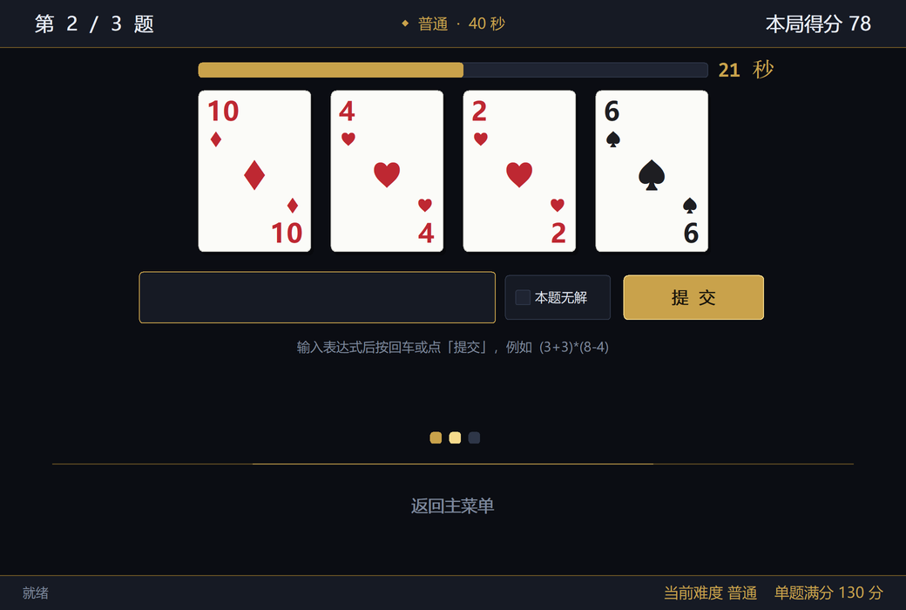
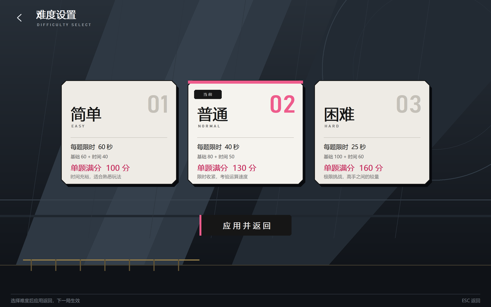
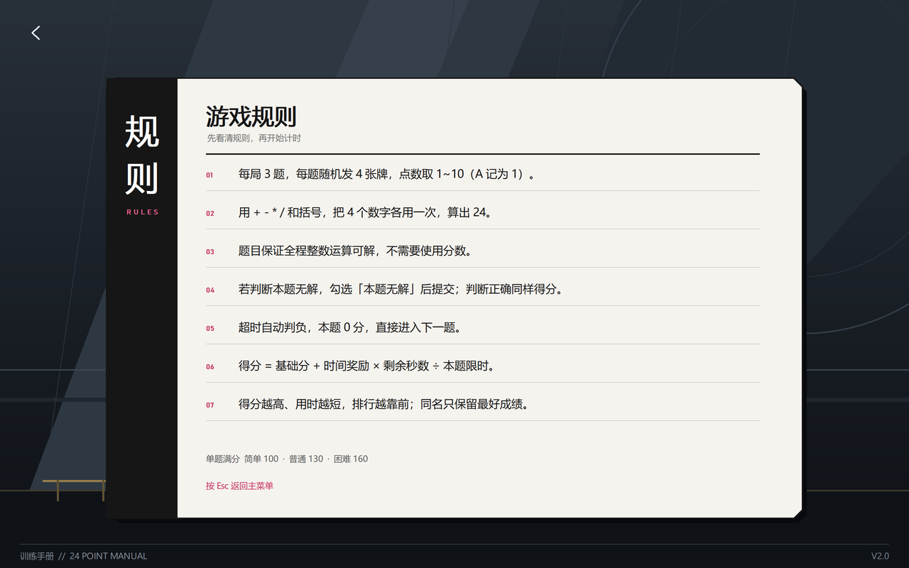

<a id="en"></a>

# 24 Point Game

🌐 **English** | [简体中文](#zh)

Course project for *Programming (Lab)* at Nanjing University of Posts and Telecommunications.

A small Windows desktop game written in plain Win32 API + GDI: four playing cards
(values 1–10) are dealt at random, and the player must type an arithmetic expression
that evaluates to 24 before the timer runs out.

The UI theme is "Jièyuán Terminal" (CALC-24 TERMINAL V2.0): a pink gradient backdrop
with a semi-transparent ink-wash landscape image, off-white cut-corner cards and magenta
accents. Every card, playing card, progress bar, button and barcode is hand-drawn with GDI.


## Features

- **Native window** — standard title bar (minimize / maximize / close), menu bar, freely resizable; when maximized the layout scales proportionally to fill the screen
- **Puzzle generation** — four cards with values 1–10 drawn at random; every deal is guaranteed to be solvable with integer arithmetic only (no fractions needed), and each round always contains exactly one unsolvable hand
- **Three difficulty levels** — Easy 60 s / Normal 40 s / Hard 25 s; a harder level means a higher base score and time bonus (max 100 / 130 / 160 per question)
- **Exact evaluation** — all arithmetic uses rational numbers (numerator/denominator pairs of `long long`), never floating point, so edge cases such as `8/(3-8/3)` are judged exactly
- **Leaderboard** — sorted by total score descending, then time ascending; only a player's personal best is kept, and each entry records its difficulty
- **Voice feedback** — a chime when a game starts, a reminder at half time, right/wrong feedback per question and a verdict at the summary; background music loops and automatically steps aside while a sound effect plays
- **Built-in self-test** — 25 checks covering the solver, the parser and the audio/bitmap assets, plus a 20,000-hand randomized consistency run

| | |
|---|---|
|  |  |
|  |  |
|  |  |

## Building

### Option 1: one-command build (recommended)

Requires `g++` and `windres` from MinGW-w64 / TDM-GCC — either on `PATH` or in one of the
common install directories, which the script probes automatically.

```powershell
.\build.ps1
```

Or press `Ctrl+Shift+B` in VS Code (runs the 「构建」 task in `.vscode/tasks.json`).

The script first packs `音频\*.mp3` and `图片\背景.bmp` into a resource object with `windres`,
then statically links a single-file exe that does not depend on `libstdc++-6.dll`.

### Debug build

```powershell
.\build.ps1 -Debug
```

Produces `calc24-debug.exe` (`-g -O0`, symbols kept) for gdb breakpoint debugging; without
the switch it still produces the optimized `计算24点游戏.exe`.
In VS Code, pick the 「C++ 调试 · 计算24点游戏 (MinGW gdb)」 configuration — it runs the
「构建(调试)」 task first and then launches gdb.

### Option 2: manual build

```bash
windres src/计算24点游戏.rc -O coff -o src/资源.o --codepage=936
g++ -std=c++11 -O2 -mwindows -static -static-libgcc -static-libstdc++ -s \
    -o 计算24点游戏.exe src/计算24点游戏.cpp src/资源.o -lgdi32 -lwinmm -lmsimg32
```

- `-mwindows` — build a GUI subsystem app without the black console window
- `-lwinmm` — MCI audio API
- `-lmsimg32` — `AlphaBlend`, used to composite the background image
- `--codepage=936` — the resource script references Chinese file names, so it must be parsed as GBK
- `-static -s` — statically link the runtime and strip symbols, so the exe runs on any machine

> ⚠️ **The source files are GBK / ANSI encoded.** When opening them in VS Code choose
> “Reopen with Encoding → GBK”. **Never save them as UTF-8** — that permanently corrupts
> the Chinese string literals in the source.

### Editor IntelliSense

VS Code uses clangd for C/C++ hints by default, but clangd ships with MSVC header search
paths, so it cannot find `windows.h` and floods the editor with bogus errors such as
`'windows.h' file not found` and `Unknown type name 'COLORREF'` — even though compiling
with g++ works fine. Two config files are included to solve this:

- `compile_flags.txt` — tells clangd to target MinGW (`--target=x86_64-w64-windows-gnu`) and where w64devkit's headers live;
- `.clangd` — suppresses two known clashes (`builtin_definition`, `redefinition_different_typedef`) that occur when clang parses mingw-w64 headers; they are not issues in this project's code.

If you use a different toolchain location or GCC version, edit the paths in
`compile_flags.txt` (run `g++ -E -v -x c++ nul` to see the actual
`#include <...> search starts here` list).
`.vscode/c_cpp_properties.json` is the equivalent configuration for the Microsoft C/C++ extension.

## Running

Just double-click `计算24点游戏.exe`. The audio is embedded in the exe, so a
**single file copied to someone else's machine still plays sound**.

If an `音频\` folder sits next to the exe, external assets take priority — handy for
swapping sound effects.

The background is drawn by `paintBackground`: a pink-to-white gradient base, a semi-transparent
ink-wash landscape (`图片\背景.bmp`, with the watermark at the bottom of the original image
cropped away) composited on top, and finally two gradient black bands pressed against the top
and bottom edges. The image is scaled with “cover” semantics and centre cropping, so it is never
stretched. The opacity of the `AlphaBlend` composite is controlled by `BG_ALPHA` — raise it for
a more vivid picture, lower it for clearer text. Everything is laid out on a 1280×800 logical
canvas; the backdrop is rendered once at the real pixel size into a cached bitmap, and every
subsequent frame just blits it. If the bitmap resource is missing (e.g. the resources were not
compiled in), the drawing silently falls back to the pure gradient and the UI stays intact.

Command-line arguments:

| Argument | Description |
|---|---|
| `--selftest` | Run the built-in self-test; exit code 0 means everything passed |
| `--selftest --log` | Same, but write the results to `selftest.log` instead of a console |
| `--shots` | Export each screen as a BMP, used for the report figures |

## Project layout

```
计算24点游戏/
├── 计算24点游戏.exe     entry point
├── rank.txt             leaderboard data (written by the game, git-ignored)
├── 音频\                7 mp3 sound assets
├── 图片\背景.bmp         background image (ink-wash landscape, embedded in the exe)
├── build.ps1            one-command build script (locates g++ / windres)
├── compile_flags.txt    clangd flags (MinGW target and include paths)
├── .clangd              clangd config (suppresses known mingw header false positives)
├── .vscode\             VS Code build / run tasks
├── src\                 source code
│   ├── 计算24点游戏.cpp  main program (GBK encoded, ~3850 lines)
│   ├── 计算24点游戏.c++  identical submission copy of the source
│   └── 计算24点游戏.rc   resource script (mp3 as RCDATA, background as BITMAP)
├── doc\
│   ├── 使用说明.txt       detailed manual and defence notes
│   └── screenshots\     UI screenshots
├── README.md            this file (bilingual)
└── .gitignore
```

> The executable, `音频\` and `rank.txt` must live in the same directory: the program uses
> `GetModuleFileName` to locate its own folder and resolves assets and data relative to it.

## Implementation notes

- **Solver** — recursively enumerate every combination of “take any two numbers and apply one
  operation”. Each level has C(n,2) pairs × 6 operand orders, and the search is exhaustive, so
  “no solution” is decided exactly. An extra `intOnly` flag requires every intermediate result to
  be an integer; puzzle generation uses it to reject hands that can only be solved with fractions.
- **Expression parser** — recursive descent (expression → term → factor) sharing the same exact
  fraction arithmetic as the solver, so the player's answer is judged by exactly the same
  standard used to generate the puzzle.
- **Rendering** — the whole client area is owner-drawn. `WM_PAINT` first renders the frame into a
  memory bitmap and then performs a single `BitBlt` (strict double buffering: only one blit is
  ever allowed onto the window DC), combined with the `MM_ANISOTROPIC` mapping mode for
  proportional scaling. The countdown repaints only its own strip, which avoids full-screen
  refreshes and the flicker they cause.
- **Background image** — `图片\背景.bmp` is compiled in as a BITMAP resource, scaled to the content
  area with “cover” semantics and centre cropping, then composited semi-transparently over the
  gradient with `AlphaBlend` (opacity: `BG_ALPHA` in the source). To change it, replace the bmp
  and rebuild.
- **Audio** — asynchronous playback through MCI's `mciSendString`. Background music and sound
  effects use two separate aliases: a sound effect first issues `pause bgm` and, once
  `MM_MCINOTIFY` reports completion, `resume bgm` restores the music.

## Credits

The UI redesign (the “Jièyuán Terminal” theme, the 1280×800 design canvas, and the cut-corner
card and icon drawing routines) was done by a teammate. The logic layer (solver, scoring,
leaderboard, audio, self-test) and the first version of the UI are the repository's existing code.

---

<a id="zh"></a>

# 计算 24 点游戏

🌐 [English](#en) | **简体中文**

南京邮电大学《程序设计（上机）》课程设计作品。

一个纯 Win32 API + GDI 自绘的 Windows 桌面小游戏：随机发 4 张扑克牌（点数 1~10），
玩家在限时内输入四则运算表达式，使结果等于 24。

界面主题为「界园终端」（CALC-24 TERMINAL V2.0）：粉色渐变打底、半透明樱花山水背景、
米白切角卡片与品红强调色，所有卡片、扑克牌、进度条、按钮、条形码均由 GDI 手绘。

## 功能

- **原生窗口**：标准标题栏（最小化 / 最大化 / 关闭）、菜单栏、可自由缩放，最大化时界面等比铺满
- **题库**：随机出 1~10 的四张牌，保证全程用整数四则运算即可解出（不涉及小数）；每局固定含 1 道无解题
- **三档难度**：简单 60 秒 / 普通 40 秒 / 困难 25 秒，难度越高基础分与时间奖励越高（单题满分 100 / 130 / 160）
- **精确求值**：全程有理数（分数）运算，不使用浮点，避免 `8/(3-8/3)` 这类边界误判
- **排行榜**：按总分降序、用时升序排列，同名玩家只保留最好成绩，记录难度
- **语音反馈**：开场「叮叮叮」、时间过半提醒、答对/答错反馈、结算褒贬；背景音乐循环播放，音效响起时自动让位
- **内置自检**：25 项算法、解析器与素材检查 + 20000 组随机题自洽性验证

## 编译

### 方式一：一键构建（推荐）

需要 MinGW-w64 / TDM-GCC 的 `g++` 与 `windres`（在 PATH 中，或装在常见目录下即可自动找到）。

```powershell
.\build.ps1
```

或在 VS Code 中按 `Ctrl+Shift+B`（走 `.vscode/tasks.json` 里的「构建」任务）。

脚本会先 `windres` 把 `音频\*.mp3` 与 `图片\背景.bmp` 打进资源，再静态链接出单文件 exe（不依赖 `libstdc++-6.dll`）。

### 调试构建

```powershell
.\build.ps1 -Debug
```

产出 `calc24-debug.exe`（`-g -O0`，不剥离符号），供 gdb 断点调试使用；不改参数时仍生成优化过的 `计算24点游戏.exe`。
VS Code 中选择「C++ 调试 · 计算24点游戏 (MinGW gdb)」配置即可，它会先跑「构建(调试)」任务再启动 gdb。

### 方式二：手动编译

```bash
windres src/计算24点游戏.rc -O coff -o src/资源.o --codepage=936
g++ -std=c++11 -O2 -mwindows -static -static-libgcc -static-libstdc++ -s \
    -o 计算24点游戏.exe src/计算24点游戏.cpp src/资源.o -lgdi32 -lwinmm -lmsimg32
```

- `-mwindows`：生成窗口程序，不带黑色控制台
- `-lwinmm`：MCI 音频接口
- `-lmsimg32`：`AlphaBlend` 半透明贴背景图
- `--codepage=936`：资源脚本里是中文文件名，需要按 GBK 解析
- `-static -s`：静态链接运行库并去符号，exe 换台机器也能跑

> ⚠️ **源文件为 GBK / ANSI 编码**。用 VS Code 打开请选择「通过编码重新打开 → GBK」，
> **千万不要另存为 UTF-8**，否则源码里的中文字符串会被永久破坏。

### 编辑器智能提示（IntelliSense）

VS Code 默认用 clangd 提供 C/C++ 提示，而 clangd 自带的是 MSVC 头文件搜索路径，
找不到 `windows.h`，于是会满屏报 `'windows.h' file not found`、`Unknown type name 'COLORREF'`
这类假错误（实际用 g++ 编译是通过的）。仓库里已经带上两个配置文件解决这个问题：

- `compile_flags.txt`：告诉 clangd 用 MinGW 的目标平台（`--target=x86_64-w64-windows-gnu`）
  以及 w64devkit 的头文件目录；
- `.clangd`：屏蔽 clang 解析 mingw-w64 头文件时的两处已知冲突（`builtin_definition`、
  `redefinition_different_typedef`），它们不是本项目的代码问题。

如果换了工具链安装位置或 GCC 版本，把 `compile_flags.txt` 里的路径改成自己的
（可用 `g++ -E -v -x c++ nul` 查看实际的 `#include <...> search starts here` 列表）。
另外 `.vscode/c_cpp_properties.json` 是给 MS C/C++ 扩展用的同类配置。

## 运行

双击 `计算24点游戏.exe` 即可。声音已打包进 exe，**单独一个文件拷给别人也能出声**。

如果 exe 旁边存在 `音频\` 目录，会优先使用外置素材（方便替换音效）。

界面背景由 `paintBackground` 画：淡粉到白的渐变打底，上面半透明叠一张写意山水图（`图片\背景.bmp`，
已裁掉原图底部的水印），最后压上下两条带渐变的黑色横带。背景图按「等比铺满、居中裁边」缩放，
不拉伸变形；`AlphaBlend` 的不透明度由 `BG_ALPHA` 控制，调高画面更清晰、调低文字更清楚。
图按 1280×800 逻辑坐标绘制，首次绘制时按实际像素渲染成位图缓存，之后每帧只贴一次图；
背景图资源缺失（例如没编资源）时自动退回纯渐变底，界面依旧完整。

命令行参数：

| 参数 | 说明 |
|---|---|
| `--selftest` | 运行内置自检，返回码 0 表示全部通过 |
| `--selftest --log` | 同上，但把结果写入 `selftest.log` 而不是弹出控制台 |
| `--shots` | 导出各界面截图（BMP），用于报告插图 |

## 目录结构

```
计算24点游戏/
├── 计算24点游戏.exe     运行入口
├── rank.txt             排行榜数据（程序自动读写，已在 .gitignore 中）
├── 音频\                7 个 mp3 声音素材
├── 图片\背景.bmp        界面底图（写意山水，已裁掉原图水印，编进 exe）
├── build.ps1            一键构建脚本（自动定位 g++ / windres）
├── compile_flags.txt    clangd 编译参数（MinGW 目标与头文件路径）
├── .clangd              clangd 配置（屏蔽 mingw 头文件的已知误报）
├── .vscode\             VS Code 构建与运行任务
├── src\                 源码
│   ├── 计算24点游戏.cpp  主程序（GBK 编码，约 3850 行）
│   ├── 计算24点游戏.c++  同一份源码的提交副本
│   └── 计算24点游戏.rc   资源脚本（把 mp3 以 RCDATA、背景图以 BITMAP 打包进 exe）
├── doc\
│   ├── 使用说明.txt       详细使用说明与答辩要点
│   └── screenshots\       界面截图
├── README.md            本文件（中英双语）
└── .gitignore
```

> 可执行文件与 `音频\`、`rank.txt` 必须位于同一目录，因为程序用
> `GetModuleFileName` 取自身所在目录来定位素材与数据文件。

## 实现要点

- **求解器**：递归枚举「任取两个数做一次运算」的所有组合，每层 C(n,2) 组数对 × 6 种运算顺序，
  穷尽所有可能，因此可以准确判定无解。加 `intOnly` 参数后可以限制每个中间结果必须是整数，
  出题时据此剔除只能靠分数求解的题目。
- **表达式解析**：递归下降（表达式 → 项 → 因子），与求解器共用同一套分数运算，判定标准完全一致。
- **界面**：客户区全自绘，`WM_PAINT` 先把整屏画进内存位图再一次性 `BitBlt`（严格双缓冲，
  窗口 DC 上只允许一次贴图），配合 `MM_ANISOTROPIC` 映射模式实现等比缩放；
  倒计时只重画局部区域，避免整屏刷新导致闪屏。
- **背景图**：`图片\背景.bmp` 以 BITMAP 资源编进 exe，绘制时按「等比铺满、居中裁边」缩放到正文区，
  再用 `AlphaBlend` 半透明叠在渐变底上（不透明度见源码里的 `BG_ALPHA`），换图只需替换这个 bmp 重新编译。
- **声音**：MCI 的 `mciSendString` 异步播放，背景音乐与音效使用两个独立别名，
  音效开始时 `pause bgm`、播完收到 `MM_MCINOTIFY` 后 `resume bgm`。

## 协作说明

界面改版（「界园终端」主题、1280×800 设计画布、切角卡片与图标绘制）由组员完成；
逻辑层（求解器、计分、排行榜、音频、自检）与初版界面为本仓库既有代码。
